# Together Todolist

> 一起把时间用在值得的地方

Together Todolist 是一款轻量的时间日志 Web 应用，帮助你记录每天的时间去向，回顾投入分布，找回时间的掌控感。支持多用户，提供 Android 安装包。

---

## 界面预览

### 桌面端

| 日视图 | 周视图 |
|:---:|:---:|
| 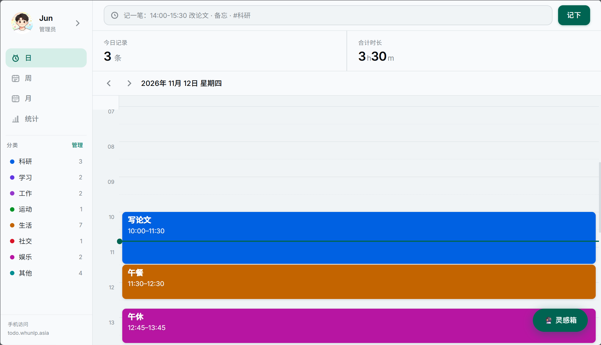 | 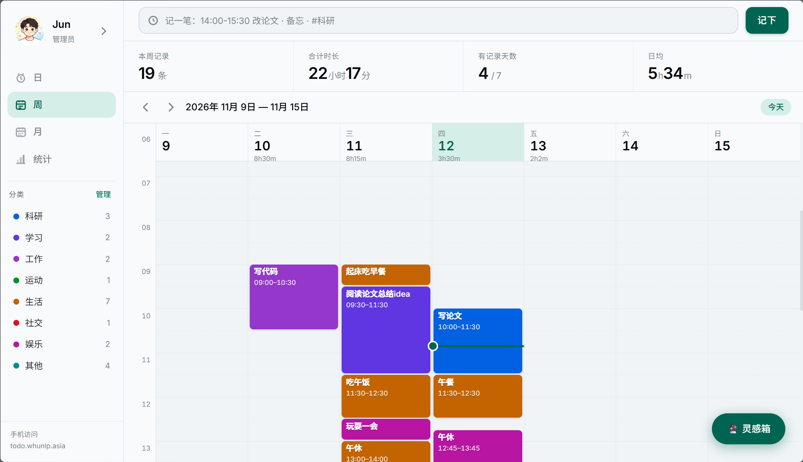 |

| 月视图 | 统计 |
|:---:|:---:|
| 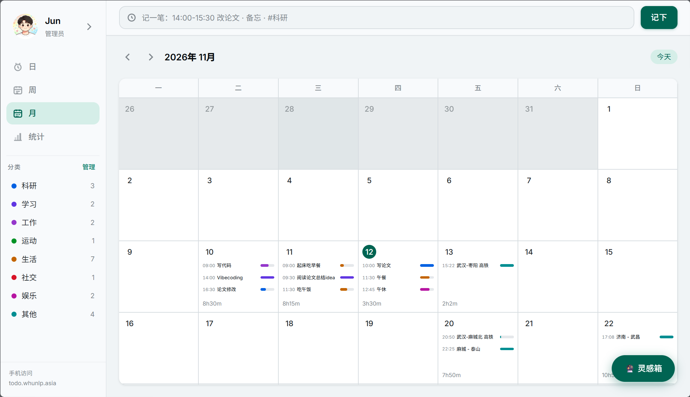 | 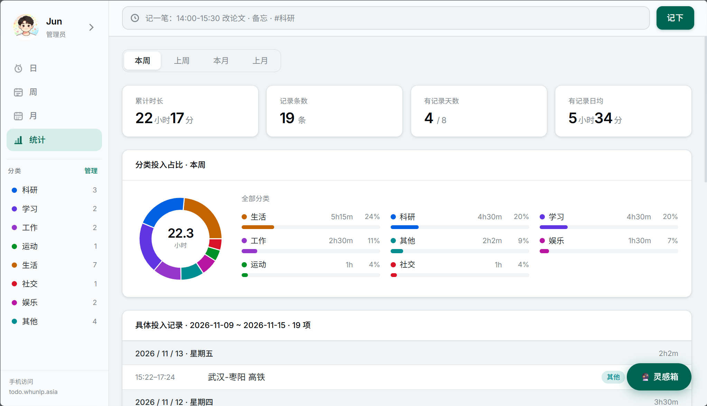 |

### 手机端（Android APK）

<p align="center">
  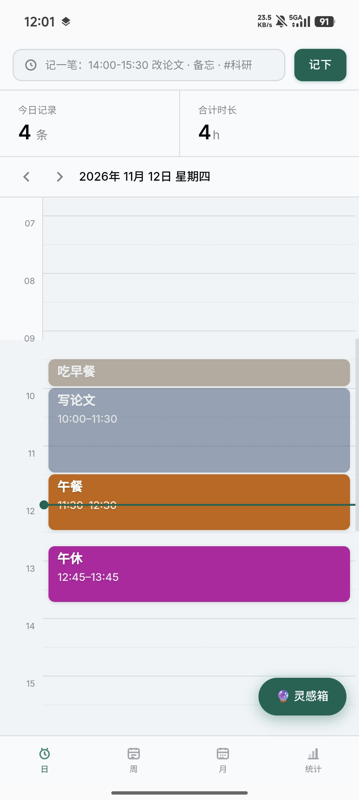
  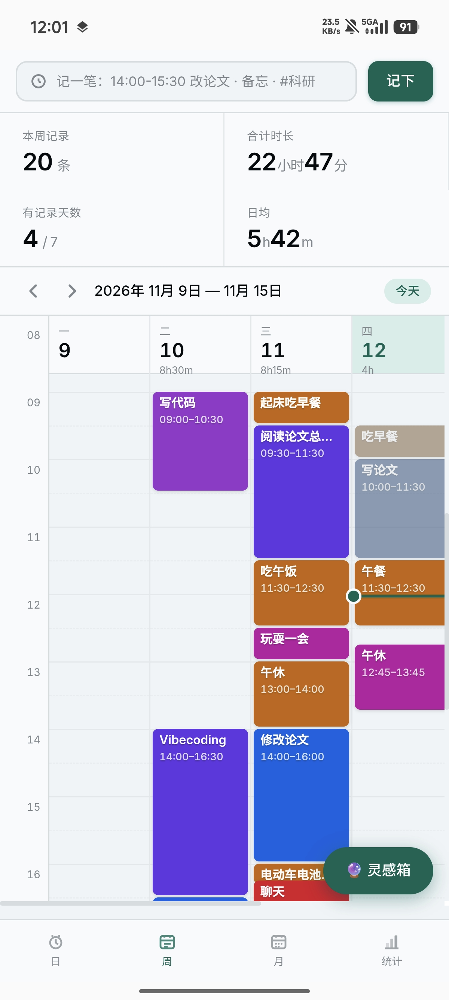
  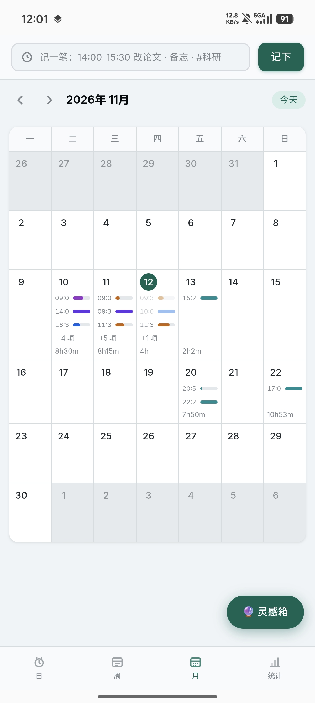
  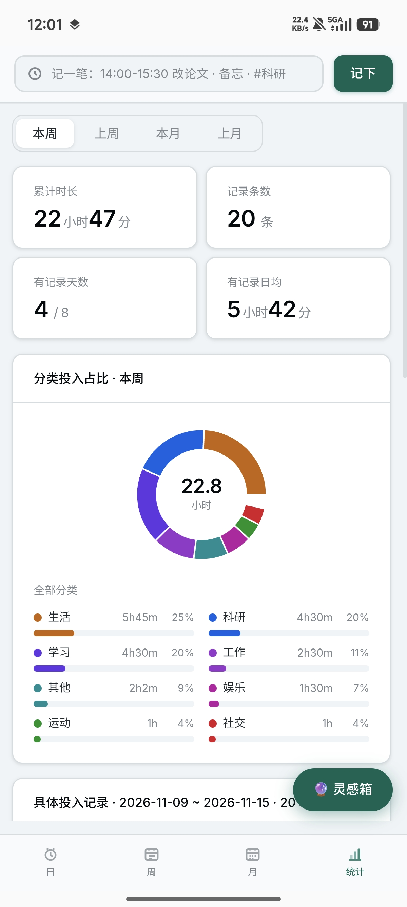
  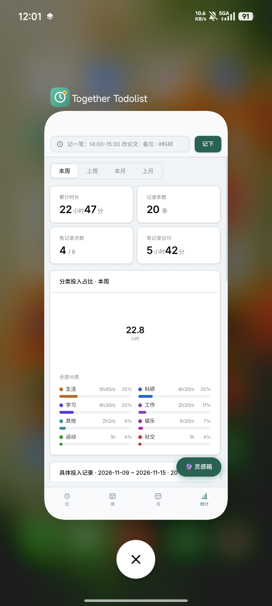
</p>

### iPhone / iOS（添加到主屏幕）

<p align="center">
  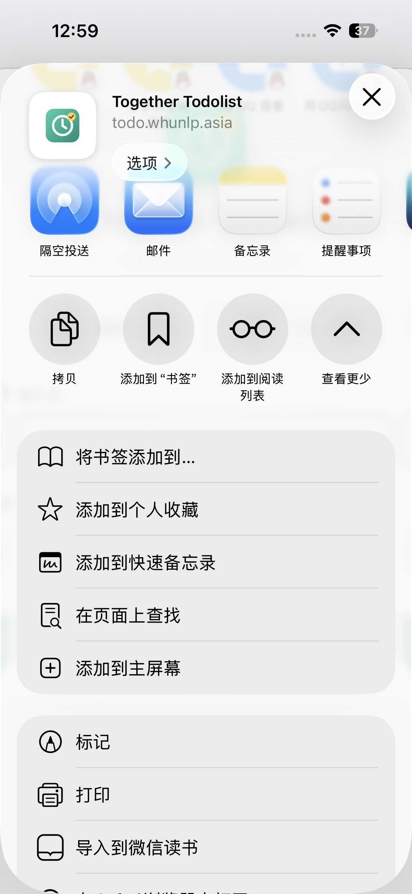
  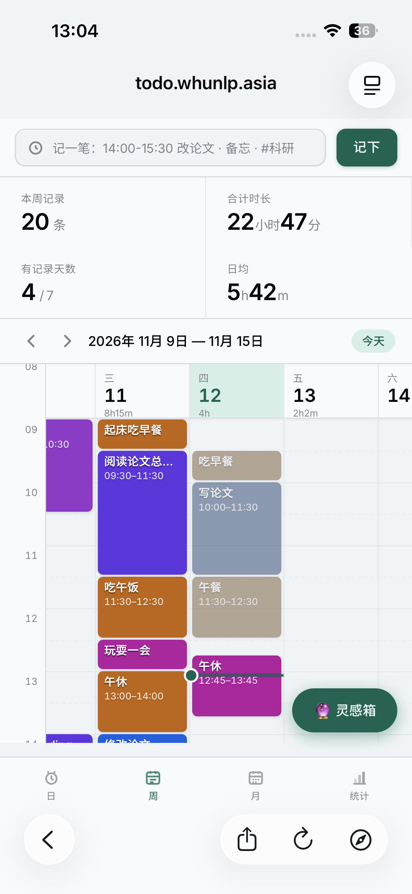
  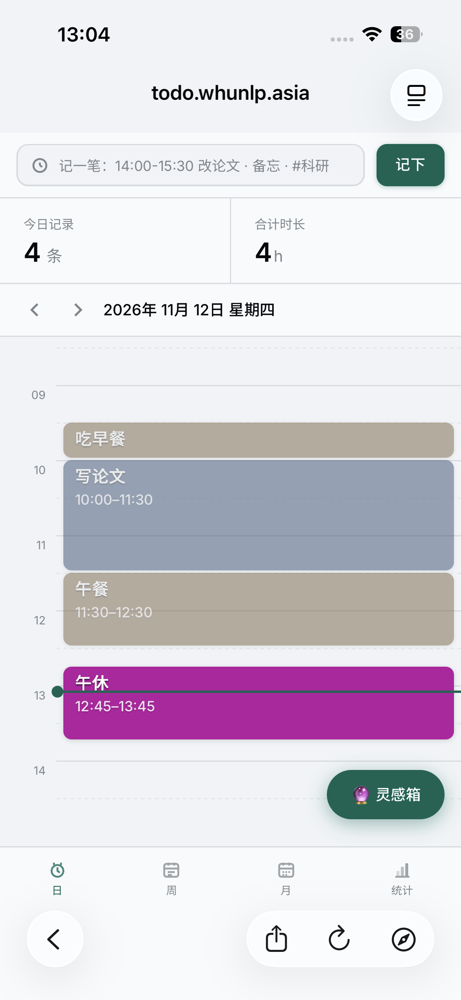
  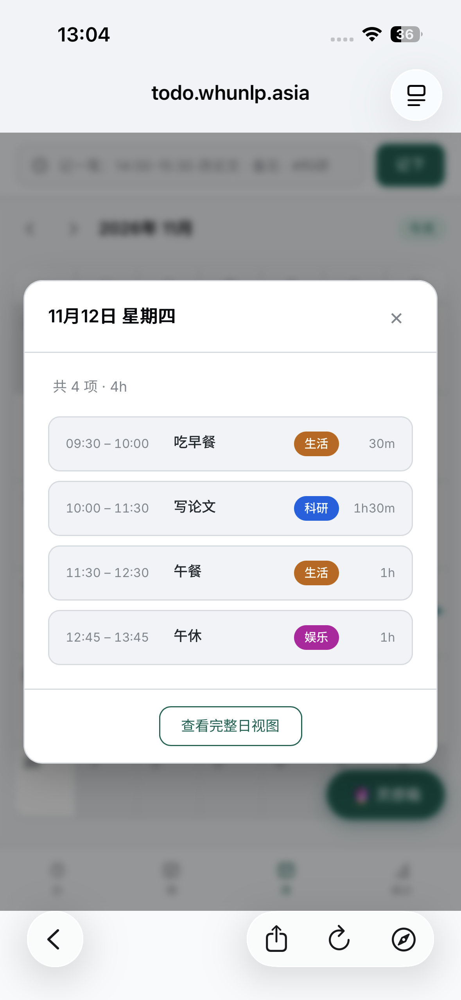
  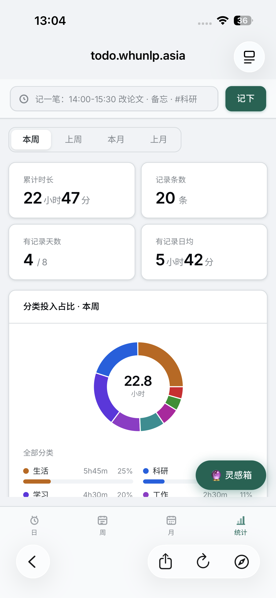
</p>

---

## iOS 使用方式

Together Todolist 支持 iOS 添加到主屏幕，体验接近原生 App，无需 Apple 开发者账号，无需 App Store，永不失效。

**安装步骤**

1. 用 **Safari** 打开 [https://todo.whunlp.asia](https://todo.whunlp.asia)
2. 点击底部工具栏中间的 **分享按钮**（方框加箭头图标）
3. 在弹出菜单中找到 **「添加到主屏幕」**，点击
4. 确认名称为 **Together Todolist**，点击右上角 **「添加」**
5. 主屏幕上出现图标，点击即可全屏启动，与原生 App 体验一致

**说明**

- 必须用 **Safari** 操作，Chrome/微信内置浏览器不支持添加主屏幕
- 需要联网访问域名，数据存储在服务端，换设备登录即可同步
- 最低支持 iOS 16.4（iPhone 8 及以上）
- 添加后图标样式与应用内图标一致，启动时无地址栏

---

## 核心功能

**时间记录**
- 顶栏快速输入，支持自然语言：`14:00-15:30 改论文 · 备注 · #科研`
- 支持灵活时间格式：`9:00`、`17.08`、`9点`、`9点半`
- 支持跨天时间段，次日结束勾选即可
- 点击日历格子或拖动时间轴快速新建记录

**多视图日历**
- **日视图**：24 小时时间轴，按分类着色，今天的进度线实时滚动
- **周视图**：一周概览，每天的记录条目并排显示，周统计汇总
- **月视图**：月历格子，每天显示记录摘要，点击弹出当日详情
- 支持按分类过滤，全视图联动

**统计分析**
- 本周 / 上周 / 本月 / 上月 多周期切换
- 累计时长、记录条数、有记录天数、日均投入一览
- 分类投入占比：环形图 + 多列自适应条形列表
- 具体投入记录明细，按日汇总

**分类管理**
- 内置 8 个默认分类：科研、学习、工作、运动、生活、社交、娱乐、其他
- 支持自定义名称和颜色，侧栏显示每个分类的记录数
- 点击分类一键过滤所有视图

**灵感箱**
- 随时捕捉想法，支持将灵感一键转化为日程记录

**多用户体系**
- 账号注册与登录，密码 scrypt 哈希，Session Cookie 认证
- 每个账号的数据完全隔离，互不可见
- 管理员账号可管理所有用户，支持一键开关注册
- 个人信息页：修改昵称、邮箱、简介、上传头像（带裁切）、改密码

---

## 技术栈

| 层 | 技术 |
|---|---|
| 前端 | React 18 + TypeScript + Vite |
| 路由 | React Router v6 |
| 状态 | Zustand |
| 图表 | Recharts |
| 日期 | date-fns |
| 后端 | Node.js + Vite SSR middleware |
| 数据库 | SQLite（`node:sqlite`，内置，无额外依赖） |
| 认证 | scrypt 密码哈希、HttpOnly Session Cookie、登录限流 |
| Android | Capacitor（加载线上域名） |

---

## 本地部署

### 环境要求
- Node.js 22+

### 步骤

```bash
# 克隆并安装依赖
git clone https://github.com/Robert-solo/together-todolist.git
cd together-todolist
npm install

# 开发模式（含热更新）
npm run dev

# 生产构建后预览
npm run build
npm run preview
```

服务默认在 `http://localhost:5173` 启动。

首次访问时，会引导你创建第一个管理员账号。已有旧数据时，账号建好后旧数据会自动归入该账号。

### 数据存放
- 数据库：`data/zhiri.db`（SQLite，自动创建）
- 头像：`data/uploads/`

---

## Android 安装包

在 [Releases](https://github.com/Robert-solo/together-todolist/releases) 页面下载最新的 `.apk` 文件。

**安装步骤**
1. 下载 APK 到手机
2. 打开后如提示「安装未知应用」，允许即可
3. 安装完成，使用账号登录

> APK 是 Capacitor 外壳，加载线上服务 `https://todo.whunlp.asia`。手机需能访问该域名，网页更新后无需重新安装。最低支持 Android 7.0。

---

## 项目结构

```
├── server/
│   ├── api.js          # 数据 API（需登录）
│   ├── auth.js         # 认证 / 账号管理 API
│   └── db.js           # SQLite 数据层
├── src/
│   ├── components/     # UI 组件（Calendar、Stats、Layout、Profile…）
│   ├── pages/          # 页面（Login、Setup、Profile、AdminUsers…）
│   ├── store/          # Zustand 状态（authStore、entryStore、uiStore）
│   ├── utils/          # 工具函数（时间解析、冲突检测…）
│   └── api/            # API 客户端
├── android/            # Capacitor Android 工程
├── public/             # 静态资源（图标）
└── data/               # 运行时数据（gitignore）
```

---

## License

MIT
